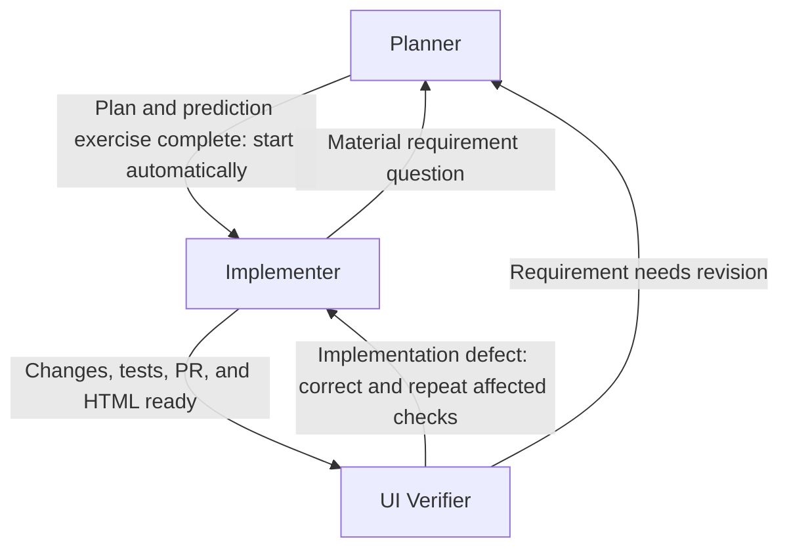

# Terminology skill graph

## Communication

- Refer to yourself as "the system".
- Use ASD-STE100 controlled English. Use short sentences and direct instructions.
- Critique weak assumptions. Do not use encouragement in place of analysis.
- Support repository claims with file paths and line numbers. Mark assumptions
  and unverified behavior.

## Routing

Use these three roles for app features and behavior changes. Read the selected
skill before you use it. Keep the roles in the current chat unless the user
requests separate agents. These files define the workflow; they are not an
executable scheduler.

| Role | Skill | Required result |
| --- | --- | --- |
| Planner | [.agents/skills/planner/SKILL.md](.agents/skills/planner/SKILL.md) | Interview, user prediction, plan, expected change diagram, acceptance criteria, and scenarios. |
| Implementer | [.agents/skills/implementer/SKILL.md](.agents/skills/implementer/SKILL.md) | Changes, tests against the plan, actual change diagram, PR, and HTML explanation. |
| UI Verifier | [.agents/skills/ui-verifier/SKILL.md](.agents/skills/ui-verifier/SKILL.md) | Evidence and user review for each scenario, one at a time. |

- Start a rough idea with the Planner. Ask one interview question at a time.
- Start the Implementer automatically when the plan and prediction exercise are
  complete. Do not request another approval to start implementation.
- Start UI review when the implementation handoff is ready. Present only one
  scenario. Wait for the user's response before starting the next scenario.
- A test pass does not mean that the user has reviewed the scenario.
- A defect returns to the Implementer. A material requirement change returns to
  the Planner. Preserve prior answers and completed work.
- If a required tool or service is unavailable, record the exact blocked step.
  Complete independent work. Do not claim that the blocked step passed.
- Do not start a new feature interview for a request that only asks to inspect
  code, explain a result, run a check, or edit these workflow instructions.
  For a resume request, use the saved task record and current Git state.

## Shared task record

For each app change, keep one Markdown record at
`docs/skill-graph/<task-slug>.md`. Reuse it across all three roles. Create it when
feature work starts; do not create empty task records in advance.

Keep these items current:

- Goal, scope, branch, comparison base, current role, and next action.
- The four knowledge groups, user answers, decisions, and open questions.
- The user's system-change prediction, recorded before the system's answer.
- The plan and expected change diagram, with source references.
- Acceptance criteria with stable IDs, such as `AC-1`. For each criterion, record
  observable behavior, planned test, actual evidence, and result.
- An ordered scenario list with stable IDs, such as `SC-1`. Record its acceptance
  criteria, setup, actions, expected result, test selector, evidence path, test
  result, and user review status. Separate test status from user review status.
- Existing pattern examples, new pattern decisions, actual changes, and plan
  differences. Include the completed change diagram.
- Test commands and results, PR URL, HTML path, and validation limits.
- The current scenario, user feedback, required corrections, and next scenario.

Before resuming, compare the record with the current branch, diff, and test
artifacts. Invalidate affected evidence if the code or scenario has changed.
Do not treat an old test result as evidence for new code.

## Repository evidence

Read the relevant source before each change. These are starting points, not a
fixed list of files to edit:

- UI composition: `frontend/src/App.tsx` and `frontend/src/terms/Term.tsx`.
- Shared state: `frontend/src/provider.tsx` and `frontend/src/context.tsx`.
- Queries and mutations: `frontend/src/hooks.tsx`.
- HTTP requests and errors: `frontend/src/actions.tsx` and
  `frontend/src/api-errors.ts`.
- API and persistence: `api/main.py`, `api/models.py`, `api/nodes.py`, and
  `api/database.py`.
- API tests: `tests/test_api.py`. Frontend unit tests: `frontend/tests/`.
- Browser tests: `frontend/e2e/`. Setup and run rules: `docs/e2e-testing.md`.
- Required CI commands: `.github/workflows/e2e.yml`. Frontend scripts:
  `frontend/package.json`.

Use the isolated E2E wrapper. Do not run Playwright tests directly against a
user's running app. The current runner passes test filters through to Playwright.
The current media defaults retain screenshots, traces, and video only on
failure. Successful scenario reviews need explicit evidence capture.

## Completion

Complete the workflow after the planned criteria have evidence, the PR and HTML
are available, and each applicable UI scenario has a recorded user review.
If the change has no visible UI effect, record why UI scenarios do not apply.
Report failures, skipped checks, and missing evidence. Do not label incomplete
work as complete. PR creation does not authorize merging or deployment.
