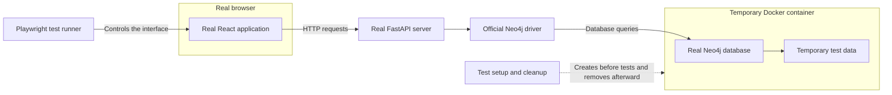

# Run the E2E tests

The suite tests term creation, lookup, editing, deletion, validation, and error
display. Chromium and WebKit run one test at a time. Failed tests are not retried.



## Requirements

- Node.js 26.12.1 and its npm installation (the CI version).
- Python 3.11.18, available as `python3.11`.
- Docker Engine 24 or later, running locally. Local verification uses Docker
  Desktop with Engine 29.5.3. The suite does not start Docker Desktop for you.
- Local testing targets macOS Apple Silicon. CI uses Ubuntu 24.04.
- Internet access for initial dependency, browser, and database image downloads.

The database image is pinned by digest to the Neo4j 2026.06.0 image used in stage
one. The image includes both ARM64 and AMD64 builds. This avoids the moving
`neo4j:latest` tag. Python versions for this suite are in
`frontend/e2e/requirements.txt`; these do not upgrade the application packages.

## Run locally

From the repository root:

```sh
npm ci --prefix frontend
npm run test:e2e:setup --prefix frontend
npm run test:e2e --prefix frontend
```

Setup creates `frontend/.e2e/venv` and installs Playwright's Chromium and WebKit
binaries. It does not modify your existing Python environment. If Python has a
different executable path, set it for setup:

```sh
E2E_PYTHON=/path/to/python3.11 npm run test:e2e:setup --prefix frontend
```

To see the browsers:

```sh
npm run test:e2e:headed --prefix frontend
```

To run one browser or one test group:

```sh
npm run test:e2e --prefix frontend -- --project=chromium
npm run test:e2e --prefix frontend -- --grep 'real HTTP'
```

Do not run Playwright directly. The wrapper creates the isolated stack and sets
its control configuration. The configuration rejects a direct unprepared run.
`--prefix frontend` tells npm to use the scripts in the frontend folder.

## Results and cleanup

Each run prints its directory under `frontend/e2e-artifacts/run-*`:

- `report/index.html`: HTML results.
- `results.json`: Machine-readable results.
- `test-results/`: Screenshots, traces, and video for failed tests.
- `api.log`, `frontend.log`, `neo4j.log`: Test service logs.
- `database-version.txt`: Actual database version.
- `cleanup.json`: Cleanup result and any cleanup errors.

`frontend/e2e-artifacts/last-run.json` identifies the latest run. Open its HTML
report with Playwright, replacing the example directory:

```sh
cd frontend
npx playwright show-report e2e-artifacts/run-EXAMPLE/report
```

Reports and the Python test environment are ignored by Git. Normal completion,
test failure, Ctrl+C, and termination remove test-owned processes, the database
container, its volumes, and the API's temporary working directory. Reports stay
available. A forced kill or machine shutdown cannot run cleanup; use the exact
container name in `last-run.json` to inspect and remove only that test instance.

## Troubleshooting

- **Occupied ports:** The suite requires ports 3030 and 8000. Stop your own app
  before testing. The runner refuses to reuse or terminate existing services.
- **Docker unavailable:** Start Docker Desktop and confirm `docker info` works.
- **Missing Python or browsers:** Run the setup command again. Check the required
  Python version.
- **Database readiness failure:** Read `neo4j.log`. Docker needs sufficient memory
  for the temporary database.
- **Failed test:** Open the report and inspect the trace. Do not hide a failure by
  skipping the assertion. See `e2e-findings.md` for confirmed application defects.

## CI

The `CRUD E2E` workflow runs on pull requests and manual dispatch. One job runs
existing Python/frontend tests, build and lint checks, then both E2E browsers.
The existing opt-in Python database test is skipped in the unit-test step; the
E2E suite performs the live database checks. Reports and logs are uploaded even
when a test fails and are retained for 14 days.
