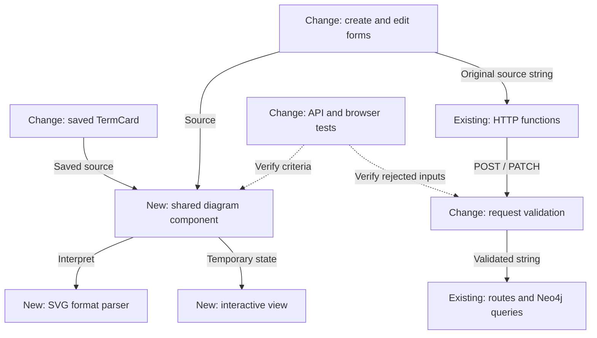
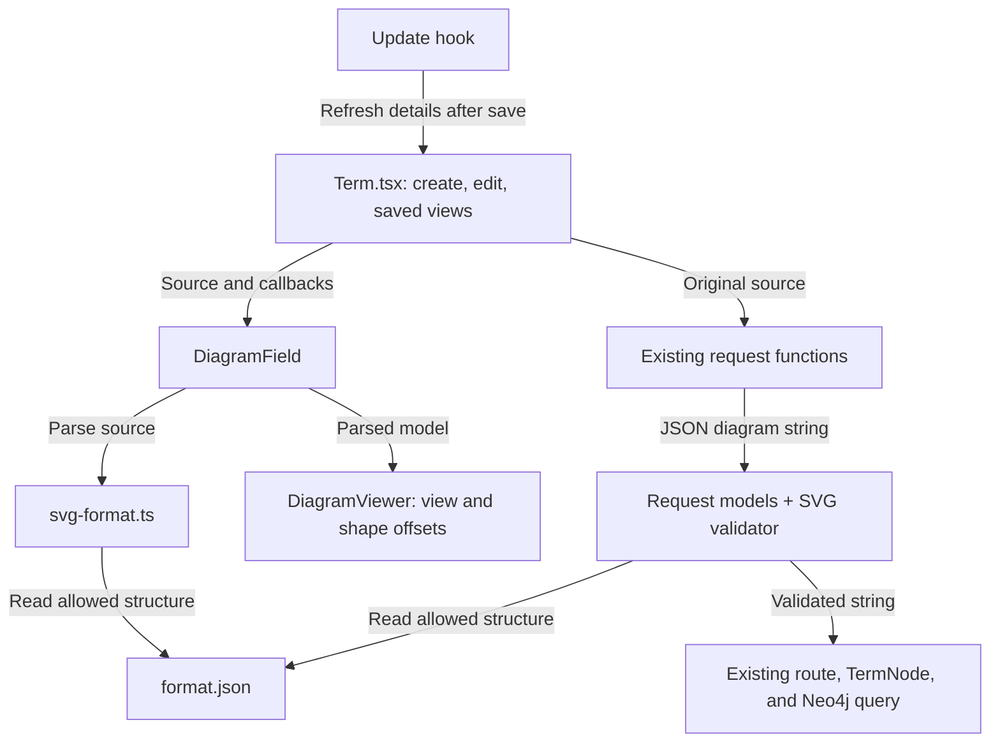

# SVG diagram source and preview

## State

- Started: 2026-11-23. Last updated: 2026-11-24.
- Current role: UI Verifier.
- Stage: SC-1 evidence ready; waiting for user review.
- Starting branch: `feature/skill-graph-orcehstration`.
- Starting commit and comparison base: `849986f9331766618ed9f9fe738ab692217a2cf2`.
- Implementation branch: `feature/svg-diagram-preview`.
- Next action: Wait for the user response to SC-1. Do not start SC-2 yet.
- Implementation: Committed as `b137a1086403a52ff3b79962f7c1e777d09e0491`.
- PR: https://github.com/lycho33/Terminology/pull/14 (draft). UI review: Pending.

## Known Knowns

- This task is the first app change used to test the three-skill workflow.
- Interview the user one question at a time.
- Store SVG source text in the existing Term Node diagram field in Neo4j.
- Send that source text from the frontend through the API to the database.
- Let the user switch between SVG source code and the rendered image.
- Provide the switch in the React create, edit, and saved views. The user chose
  option 1 in interview question 1.
- Let the user copy and paste the source for use elsewhere.
- The user will paste SVG code for this change. AI generation is a later feature
  and is outside the current scope.
- The user requested zoom, movement of the diagram view, dragging individual
  shapes, and clicking a shape to show details. Do not assume these actions
  require execution of scripts from pasted SVG.
- Shape movement is temporary. It does not change stored SVG source. Reopening
  the term restores saved positions.
- Connecting arrows must follow dragged shapes and keep their connections.
- Pasted SVG may follow a documented format for shape IDs, details, and
  connections. The user requested an example.
- Shape details come from the pasted SVG. Do not look up related Terms for this
  feature. Use the accepted format's title and description.
- Accept SVG only for now. Nonempty diagram values must be valid SVG before save
  (the SVG-only option selected in question 2).
- Enter SVG in Code mode and offer Preview before saving. Show the saved image
  after saving. Allow editing the source and previewing changes before saving again.
- The user suggested an SVG tag with JSX. The implementation uses React elements
  created from validated SVG data.
- After planning and the prediction exercise, start the Implementer automatically.
- Add or update tests against the plan. Review UI scenarios with the user one at
  a time and wait for each response.

## Known Unknowns

- The user's prediction is recorded and compared below.
- Expected change map was shown before implementation; actual changes are below.
- Automated evidence is recorded below. User review remains pending. The Docker
  API image and the operating system clipboard have not been verified.

## Unknown Knowns

These defaults are system planning decisions unless explicitly stated above:

- Switching views should preserve the user's current source text.
- Existing term creation and editing should remain usable.
- Copying source should not require editing a saved term.
- Keep Diagram optional and allow clearing it, consistent with existing request
  types and the clear-field E2E scenario. SVG-only applies to nonempty input.
- Preserve valid SVG source exactly, including formatting, through save and copy.
- Provide a Copy SVG action. Keep the code selectable if clipboard access fails.
- Reset temporary positions and view transforms on reopening the term, changing
  source, or choosing Reset view. Switching Code/Preview need not retain temporary
  movement. It must retain source edits.
- Existing unsupported diagram text stays available as text with a clear message.
  Do not render it or delete it automatically. Require replacement with supported
  SVG or clearing before submitting a form that includes this legacy value.

## Unknown Unknowns

These questions were identified during planning:

- Pasted SVG can contain active content or external references. Select a preview
  method that isolates the image without silently replacing stored source.
- SVG documents can use namespaces, styles, dimensions, and references that need
  different treatment from a fixed JSX SVG component.
- Existing diagrams can contain ordinary text. Decide how to handle existing
  values under the new SVG-only rule without silently deleting data.
- A preview can need a label and responsive dimensions for keyboard and screen
  reader users.

Resolution: Use the bounded format in `docs/svg-diagrams.md`. Parse approved
elements and render them through React. Reject active content and external
references. Preserve legacy text in Code view. Provide responsive dimensions,
accessible controls, and keyboard shape selection and movement.

## Source evidence inspected

These references describe the comparison base `849986f`, before the feature edit.
References to the implementation are in the actual-change section below.

- `frontend/src/terms/Term.tsx:178`: The create form has a Diagram textarea.
- `frontend/src/terms/Term.tsx:107`: The create form trims diagram source on save.
- `frontend/src/terms/Term.tsx:264`: The update form also trims diagram source.
- `frontend/src/terms/Term.tsx:361`: The update form has a Diagram textarea.
- `frontend/src/terms/Term.tsx:634`: The saved diagram is displayed as text.
- `api/models.py:19` and `api/models.py:25`: Request diagram fields accept strings.
- `api/nodes.py:10`: The Term Node diagram field is an optional string.
- `api/main.py:106` and `api/main.py:133`: Create and update queries write the
  diagram property through parameters. This is source evidence, not a live
  database round-trip test.
- `frontend/e2e/crud.spec.mjs:52` and `frontend/e2e/crud.spec.mjs:128`: Existing
  browser tests enter diagram text and clear it during editing.

## Interview

### Question 1: Scope of the source and image switch

Answered 2026-11-24: "Should be available in React with option 1."

Decision: Provide code and image views while creating, editing, and viewing a
saved term. The user can preview before saving and after saving.

### Question 2: Accepted diagram content

Answered: "For now just SVG."

Decision: Require valid SVG for nonempty diagram values before saving.

Reason: Existing browser tests save plain-text diagram content. A requirement
for SVG-only values changes validation and compatibility with existing content.

### Question 3: Initial view

Answered: "I'd like it to enter the SVG and have the option to preview the image
before saving, then after saving, can edit the SVG and see the saved image."

Decision: Start creation with code entry. Offer a preview of the current input
before save. Show the saved image after save. Allow source editing and preview
before another save. Keep the code/image switch in all three views as agreed in
question 1. Preview alone does not save changes.

### Question 4: SVG source

Answered: "Usually an AI tool, but that'll be introduced later. For now a user
will paste the SVG code."

Decision: Accept manually pasted SVG code. Do not add AI generation or an AI
integration to this change.

### Question 5: Preview capability

Answered after clarification: "Yes, I'd like it interactive."

Decision: The user wants interaction. The system had distinguished actions inside
the diagram from the app's Code/Preview controls. Ask for a concrete example to
resolve the intended behavior. External-resource requirements remain unanswered.

Evidence: MDN's SVG image guide describes image-context restrictions on
JavaScript and external resources. An image preview is a candidate, not a final
implementation decision. Source:
https://developer.mozilla.org/en-US/docs/Web/SVG/Guides/SVG_as_an_image#restrictions

### Question 6: First interaction

Answered: "Zoom and drag, can drag a shape and click to see more details."

Decision: Include zoom, movement of the diagram view, movement of individual
shapes, and click-to-show details. Shape movement adds editing behavior to the
original preview request. Its persistence and grouping rules remain open.

### Question 7: Save shape positions

Answered: "Temporary movement for now."

Decision: Dragging affects only the current preview. Keep source text and stored
SVG unchanged. Reopening the term restores saved positions.

### Question 8: Source of shape details

Answered: "Pasted SVG."

Decision: Read shape details from descriptive content in the SVG. A related-Term
lookup is outside this change. The exact description and grouping conventions
still need a design backed by SVG documentation.

### Question 9: Connecting lines during movement

Answered: "Follow the box and keep the connection."

Decision: Update connector geometry during temporary dragging. Preserve the
original saved source. The shape/connector relationship format remains open.

### Question 10: Input format for interaction

Answered: "The pasted SVG can follow that format. Please provide an example."

Decision: Define a small documented SVG format and provide a copyable example.
Example: `docs/skill-graph/examples/connected-shapes.svg`.

The user subsequently confirmed: "That format works. Let's continue with the
plan and the prediction exercise."

Accepted version 1 format:
- Root SVG has `xmlns`, a `viewBox`, and `data-diagram-version="1"`.
- Each movable unit is a top-level `g` with a unique `id`, `data-node="true"`,
  and a translation. Group the visible shape and its label so they move together.
- A direct `title` supplies the detail heading. A direct `desc` supplies plain
  text details for the app to show on click.
- A straight `line` identifies connected groups with `data-source` and
  `data-target`. Its initial endpoint coordinates make the SVG usable outside
  the app. During dragging, offset the matching endpoint by the node movement.
- A marker supplies the arrowhead. It follows the updated line direction.
- The app supplies interaction. The SVG example contains no scripts.
- Source text remains unchanged during interaction. These are input conventions,
  not implemented or verified app behavior yet.

Design rationale: Standard SVG line attributes describe endpoint coordinates.
They do not identify application-level source and target shapes. Guessing those
relationships from proximity can produce incorrect connections. Explicit custom
data attributes are a candidate for preserving relationships in the SVG itself.

Sources inspected:
- https://developer.mozilla.org/en-US/docs/Web/SVG/Reference/Element/line
- https://developer.mozilla.org/en-US/docs/Web/SVG/Reference/Attribute/data-*
- https://developer.mozilla.org/en-US/docs/Web/SVG/Reference/Element/g
- https://developer.mozilla.org/en-US/docs/Web/SVG/Reference/Element/desc

## Prediction exercise

User prediction, recorded before the system's change map:

> React will handle displaying and sending the request to save the SVG and also
> the interactive UX for the SVG. The API will not need to update the PATCH and
> POST /terms since they already accept a string and SVG can just be stored as a
> string. Therefore the Term Node doesn't have to change either.
>
> For React, I'm guessing the CreateTermForm, UpdateTermForm will have to update
> to show the interactive SVG.

Comparison shown before implementation:
- Correct: React owns the display and interactions. The existing HTTP payload,
  TermNode string field, and Neo4j write queries already carry SVG source.
- Additional UI work: The saved TermCard needs the shared diagram component,
  not only the create and edit forms.
- Additional validation work: Request model validation must enforce the SVG-only
  input rule. The POST/PATCH route and persistence logic do not need changes.
- The system started the Implementer automatically after showing this comparison.

Expected map, shown before implementation:

## Behavior plan

1. Accept pasted SVG in the agreed version 1 format. Include the copyable example.
   Keep first-version support bounded to the example's grouped shapes and labels,
   translations, plain descriptions, straight connectors, and arrow markers.
2. Offer Code and Preview in create, edit, and saved views. Start create/edit in
   Code and saved view in Preview. Preview does not save changes.
3. Allow zoom, background drag to pan, and Reset view. Dragging a marked shape
   moves its full group and corresponding connector endpoints. Click without a
   drag displays that group's title and description. Preserve connections while
   zoomed or panned as well as at the initial scale.
4. Keep temporary interaction state separate from source. Saving after a preview
   drag stores the entered source, not the temporarily transformed diagram.
5. Save and retrieve source through the existing diagram field. Allow selection
   and copying of source. Reopening restores the source's original geometry.
6. Support updating source, canceling edits, and clearing the optional field.
7. Show actionable errors for malformed SVG, invalid references, duplicate IDs,
   and unsupported content. Preserve entered text after errors. Restrict preview
   to the documented declarative format; do not execute pasted scripts or load
   external resources. Check rejected inputs before persistence as well as before
   preview. Verify parser choices and supported attributes during implementation.
8. Provide keyboard controls for zoom/reset and shape detail selection. Provide
   a keyboard way to move a selected shape. Keep the preview within the term card
   at narrow widths. Use plain text for displayed descriptions.
9. Run mapped tests, create the scoped PR and HTML explanation, then review the
   UI scenarios below with the user one at a time.

Non-goals: AI generation, related-Term lookup, saving drag positions, arbitrary
SVG document support, curved connector routing, and a visual diagram authoring
tool. This is larger than a basic SVG preview because it includes shape movement
and connector updates.

## Acceptance criteria and planned evidence

The table records the plan. Actual evidence and results are mapped below.

| ID | Observable result | Planned verification |
| --- | --- | --- |
| AC-1 | The sample can be pasted and previewed before creation; source survives mode switches. | Browser create scenario; no create request before submit. |
| AC-2 | Create, retrieve, update, and reopen preserve exact valid SVG source and show the saved diagram. | API contract tests plus isolated real-database browser round trip with multiline source. |
| AC-3 | Code can be selected/copied in saved and edit views; copying is not affected by temporary movement. | Browser source and clipboard test; clipboard failure feedback and selectable fallback. |
| AC-4 | Zoom, pan, and reset work; the diagram remains usable at narrow widths. | Browser controls, transform checks, keyboard checks, and visual evidence. |
| AC-5 | Dragging either shape moves its label and connected endpoint, including after zoom/pan; source is unchanged. | Browser pointer and keyboard movement; geometry checks; source and persisted value comparison. |
| AC-6 | A click or keyboard activation shows the selected shape's title/description; a drag does not open details. | Browser selection, details, and drag-versus-click checks. |
| AC-7 | Source edits can be previewed/saved; Cancel restores saved content; clearing leaves no diagram. | Browser update/cancel/clear and persisted value assertions. |
| AC-8 | Invalid or unsupported input cannot preview or persist, retains source, and permits correction. | Validator/API cases and browser recovery, including missing connector references, duplicate IDs, active/external content. |
| AC-9 | Existing unsupported text is readable and never silently discarded; a clear recovery path is provided. | Legacy fixture display, correction/clear, and persisted-value checks. |
| AC-10 | Reopening or resetting removes temporary changes without changing source or stored data. | Browser move/reset/reopen and no-write assertions. |

## Ordered user review scenarios

Each scenario starts with isolated data. All automated scenario checks passed.
User review remains pending for all scenarios. Exact selectors and evidence are
below. Do not advance during UI review without user input.

| ID | Setup and action | Expected result | Criteria |
| --- | --- | --- | --- |
| SC-1 | Create a new term; paste the example; switch Code/Preview before saving. | Two labeled boxes and their arrow appear; source remains intact; no early save. | AC-1 |
| SC-2 | Save that term, reopen it, switch to Code, and copy the SVG. | Saved image appears; copied and returned source match the input. | AC-2, AC-3 |
| SC-3 | Open the diagram; zoom, pan, and reset with pointer and keyboard controls. | View changes and resets; narrow layout remains usable. | AC-4, AC-10 |
| SC-4 | Drag each box after zoom/pan, then reset and reopen. | Labels and arrow endpoints follow; source remains unchanged; positions reset. | AC-5, AC-10 |
| SC-5 | Click and keyboard-select each shape; also perform a drag. | Correct SVG details appear on selection; dragging does not trigger details. | AC-6 |
| SC-6 | Edit source; preview and cancel; edit again and save. | Cancel retains old source; save persists new source and image. | AC-2, AC-7 |
| SC-7 | Enter malformed/unsupported SVG or a broken connector reference, then correct it. | Actionable error, no save/render of invalid input, retained input, successful correction. | AC-8 |
| SC-8 | Clear a saved diagram and reopen. | Empty state; term remains usable. | AC-7 |
| SC-9 | Open a term with pre-existing plain-text diagram content and replace or clear it. | Text remains recoverable; correction follows SVG-only rules. | AC-9 |

## Evidence state

Example: XML parses; two groups have titles/descriptions; connector IDs resolve;
no script element. These are file checks, not browser or app verification.
Expected map: Shown above. Actual implementation and preliminary evidence follow.

## Actual implementation and pattern decisions

- `frontend/src/diagram/DiagramField.tsx`: Shared field and interactive viewer.
  It follows the existing controlled form pattern and ValidationMessages helper.
- `frontend/src/diagram/svg-format.ts`: Parse supported SVG into a bounded model.
  React creates elements from that model; raw SVG is not inserted into the DOM.
- `frontend/src/diagram/format.json`: One structural format used by both parsers.
- `api/svg_diagram.py`, `api/models.py`, and `api/errors.py`: Validate request
  values and return a stable INVALID_SVG field error before a write.
- `frontend/src/terms/Term.tsx`: Use the field in all three views and keep original
  source without trimming. Reject invalid local input before submitting.
- `frontend/src/hooks.tsx`: Invalidate cached term details after a successful edit.
  Existing code invalidated only the search list; same-name edits could show old
  diagrams. SC-6 checks the saved image without a reload.
- `Dockerfile.api`: Include the format file at the path used by the validator.
  Container runtime is not yet verified; the isolated suite starts the real API
  directly, with a disposable Neo4j container.
- `docs/svg-diagrams.md`: Supported format, example, controls, and reuse rules.
- API tests and browser tests cover the criteria. Existing test inputs that used
  arbitrary diagram text now use valid SVG. Legacy reads remain tested separately.

## Verification log

- API suite: 18 passed, 1 opt-in integration test skipped. The new API test checks
  all shared valid/invalid fixtures for POST and PATCH before DB access.
- Frontend unit tests: 5 passed. ESLint and production build passed.
- Dependency check: no broken Python requirements.
- Initial SVG browser run: 15 of 18 passed. Drag/pan checks failed. Fixed default
  text selection and focus scrolling, and scrolled test targets into view before
  sending pointer coordinates. Focused rerun: all 4 affected checks passed.
- Initial run: `frontend/e2e-artifacts/run-mYAx3w`.
- Focused rerun: `frontend/e2e-artifacts/run-fGTz0l`.
- Full browser regression: 112 passed across Chromium and WebKit. This includes
  all 18 SVG checks (9 scenarios in each engine). Evidence:
  `frontend/e2e-artifacts/run-zk6Kve/results.json`. Cleanup completed without
  failures; the disposable database container was removed.
- SC-2 uses a controlled clipboard API boundary in both engines; it verifies the
  copied string and denial fallback, not the operating system clipboard.
- SC-9 simulates a legacy GET response while using a real isolated database for
  corrected writes. It does not claim to have migrated existing user data.
- User scenario review: SC-1 presented with fresh evidence. Awaiting response.
  Automated checks do not count as user review.

## Acceptance evidence

These results apply to the implementation in this branch. Browser assertions
use the real isolated API and Neo4j stack except for the labeled clipboard and
legacy-read boundaries. The focused Python API contracts mock database access.

| Criterion | Actual check | Result |
| --- | --- | --- |
| AC-1 | SC-1: no POST before submit; both groups and arrow visible; exact source after switching. | Pass in both engines. |
| AC-2 | SC-2 and SC-6: exact retrieved source, reload, same-name update; `tests/test_svg_diagram.py` POST/PATCH cases. | Pass. |
| AC-3 | SC-2: exact clipboard API argument, selectable saved/edit source, denied-copy fallback; SC-4: source unchanged after movement. | Pass at clipboard API boundary. OS clipboard unverified. |
| AC-4 | SC-3: zoom/pan/reset transforms, keyboard buttons, narrow viewport screenshot. | Pass in both engines. |
| AC-5 | SC-4: pointer movement under zoom/pan, keyboard movement of other group, matching endpoint offsets. | Pass in both engines. |
| AC-6 | SC-5: pointer and keyboard details; SC-4: drag leaves details closed. | Pass in both engines. |
| AC-7 | SC-6 and SC-8: edit, cancel, save, clear, and persisted values. | Pass in both engines. |
| AC-8 | SC-7 and shared validator/API fixtures: invalid inputs rejected, source retained, correction succeeds. | Pass. |
| AC-9 | SC-9: simulated old GET value remains readable; replacement persists to real isolated database. | Pass with simulated legacy read. |
| AC-10 | SC-3 and SC-4: reset, reload, no unintended writes; save after preview movement retains source. | Pass in both engines. |

## Scenario execution and user review

All selectors below run through `npm run test:e2e --prefix frontend -- --grep
'<selector>'`. Each selects one scenario in both engines. For one-engine review,
add `--project=chromium`. The current review scenario is SC-1.

| Scenario | Selector | Screenshot from full run | Test result | User review |
| --- | --- | --- | --- | --- |
| SC-1 | `SC-1 SVG:` | `frontend/e2e-artifacts/run-zk6Kve/test-results/svg-diagram-SC-1-SVG-paste-and-preview-before-saving-chromium/preview-before-save.png` | Pass: Chromium and WebKit. | Pending. |
| SC-2 | `SC-2 SVG:` | `frontend/e2e-artifacts/run-zk6Kve/test-results/svg-diagram-SC-2-SVG-save-reopen-and-copy-exact-source-chromium/saved-source.png` | Pass: Chromium and WebKit. | Pending. |
| SC-3 | `SC-3 SVG:` | `frontend/e2e-artifacts/run-zk6Kve/test-results/svg-diagram-SC-3-SVG-zoom-pan-reset-and-narrow-layout-chromium/narrow-diagram.png` | Pass: Chromium and WebKit. | Pending. |
| SC-4 | `SC-4 SVG:` | `frontend/e2e-artifacts/run-zk6Kve/test-results/svg-diagram-SC-4-SVG-tempo-7a6a9-nections-after-zoom-and-pan-chromium/moved-with-connection.png` | Pass: Chromium and WebKit. | Pending. |
| SC-5 | `SC-5 SVG:` | `frontend/e2e-artifacts/run-zk6Kve/test-results/svg-diagram-SC-5-SVG-shape-60a58-me-from-pasted-descriptions-chromium/selected-shape-details.png` | Pass: Chromium and WebKit. | Pending. |
| SC-6 | `SC-6 SVG:` | `frontend/e2e-artifacts/run-zk6Kve/test-results/svg-diagram-SC-6-SVG-edit-cancel-and-save-new-source-chromium/edited-diagram.png` | Pass: Chromium and WebKit. | Pending. |
| SC-7 | `SC-7 SVG:` | `frontend/e2e-artifacts/run-zk6Kve/test-results/svg-diagram-SC-7-SVG-inval-5adef-tained-and-can-be-corrected-chromium/broken-connection-error.png` | Pass: Chromium and WebKit. | Pending. |
| SC-8 | `SC-8 SVG:` | `frontend/e2e-artifacts/run-zk6Kve/test-results/svg-diagram-SC-8-SVG-clear-the-optional-diagram-chromium/empty-diagram.png` | Pass: Chromium and WebKit. | Pending. |
| SC-9 | `SC-9 SVG:` | `frontend/e2e-artifacts/run-zk6Kve/test-results/svg-diagram-SC-9-SVG-simul-8b265-ves-old-text-for-correction-chromium/legacy-text-preserved.png` | Pass: Chromium and WebKit. | Pending. |

## Commands and handoff limits

- `frontend/.e2e/venv/bin/python -m pip check`: passed.
- `frontend/.e2e/venv/bin/python -m unittest discover -s tests -v`: 18 passed,
  1 opt-in database test skipped. Real-database coverage is in the browser suite.
- `npm test --prefix frontend`: 5 passed.
- `npm run build --prefix frontend`: passed.
- `npm run lint --prefix frontend`: passed.
- `npm run test:e2e --prefix frontend -- --grep 'SC-[1-9] SVG'`: initial 15/18;
  corrected pointer behavior before subsequent runs.
- `npm run test:e2e --prefix frontend -- --grep 'SC-[34] SVG'`: 4 passed.
- `npm run test:e2e --prefix frontend`: 112 passed; results and cleanup above.
- `git diff --check`: passed.
- New Python files were formatted after the full run started. This changed only
  whitespace and quoting, not behavior.
- API Docker image runtime: not tested. Its shared format file is copied to the
  validator's required path. The isolated tests run the API process directly.
- HTML: `/tmp/2026-11-24-explanation-svg-diagram-preview.html`.
  The explain-diff-html static validator passed. Quiz/browser runtime checks are
  unverified. No cmux socket was available; the browser tool rejected local file
  navigation. These limits do not affect the app E2E results above.
- PR: https://github.com/lycho33/Terminology/pull/14 (draft), base
  `feature/skill-graph-orcehstration`. Do not merge or deploy as part of this task.

## Current UI review: SC-1

- Implementation commit: `b137a1086403a52ff3b79962f7c1e777d09e0491`.
- Setup: fresh isolated services; create form named SVG preview example.
- Actions: paste the example, select Preview, then return to Code.
- Expected and observed: Client and Server boxes and their arrow appear. Source
  remains exact after switching. No POST /terms request occurs before submit.
- Command: `npm run test:e2e --prefix frontend -- --project=chromium --grep 'SC-1 SVG:'`.
- Result: 1 selected, 1 passed. Real services were available; this scenario makes
  no save request. No responses were simulated. Cleanup removed the temporary
  container without failures.
- Evidence: `frontend/e2e-artifacts/run-6npVXU/results.json` and
  `frontend/e2e-artifacts/run-6npVXU/test-results/svg-diagram-SC-1-SVG-paste-and-preview-before-saving-chromium/preview-before-save.png`.
- The system inspected the successful screenshot. It shows both boxes, their
  labels, the arrow, Code/Preview controls, and the unsaved Create action.
  No before image is available.
- User review status: Awaiting response. Feedback and required corrections: None
  received yet. Next scenario after acceptance: SC-2.
